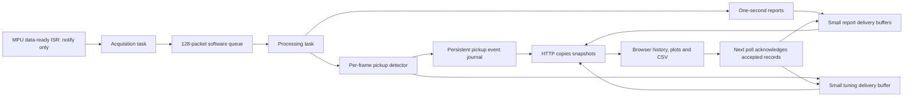

# Acquisition, processing and dashboard integration

The twelve-block implementation is complete in source. Build/test results and
hardware acceptance are separate: this document does not claim a deployment or
hardware test. Use the checklist below after installing the default build.

## Runtime ownership



| Owner | Responsibilities | Scheduling |
| --- | --- | --- |
| Setup | Sensor initialization, startup self-tests, worker creation | Before normal services |
| MPU ISR | Flag/count interrupt and notify acquisition; no I2C | GPIO17 data-ready/overflow |
| Acquisition | All runtime sensor I2C, diagnostics, FIFO recovery, BME triggers/results | Priority 2, 4096-byte stack, IRQ or 10 ms fallback |
| Processing | Sample decoding/calibration, per-frame alerts, averaging, settings, telemetry, journal writes | Priority 1, 6144-byte stack, packet/command notification or 20 ms idle service |
| Main loop | HTTP, network, BLE service and audio | Cooperative services; no sensor queue consumption |
| LED timer | LED pin updates | Independent of HTTP and OTA transfers |

Both workers are unpinned. Disabled-I2C configurations create neither worker;
main-loop fallback still maintains LED/journal state. Worker allocation failure
prevents acquisition from starting and is reported.

Acquisition owns the 100 kHz shared Wire bus after setup. MPU service precedes
BME work on every acquisition pass. BME has no ISR, so there are no two sensor
handlers nesting I2C transactions. An MPU ISR may notify during BME communication;
it returns without touching the bus.

BME forced conversions start on a fixed 200 ms grid. The previous conversion is
read before the next trigger. Its fifth result precedes the one-second boundary
packet, keeping all five values in the correct window. Missed slots are skipped;
faults or incomplete windows invalidate the report instead of publishing partial
averages. MPU samples autonomously at nominal 100 Hz; its FIFO and INT do not
synchronize the physical measurement clock to ESP32 uptime.

The software queue never blocks acquisition on a full send. Loss generations
invalidate downstream state before post-loss samples are accepted. Old motion
samples beyond the configured maximum gap are rejected. Acquisition counters
therefore count retrieved frames, not necessarily successfully processed frames.

## Locks and controls

Processing owns algorithm state and report buffers. HTTP holds its recursive
mutex only for bounded snapshot copies. Formatting, response transmission and
CSV/chart work do not hold it. Acquisition status uses a separate mutex; lock
order is processing then acquisition. No task waits for an owner command while
holding either state lock. Timing counters use a separate short spinlock; no
I2C operation runs under that spinlock.

Calibration/settings/debug subscription commands execute on processing and are
acknowledged before their callers return. Sensor diagnostics execute on acquisition.
NVS persistence can delay processing; bounded queues absorb short stalls but do
not guarantee unlimited buffering. Priority scheduling, Wi-Fi, flash and allocator
contention still contribute to latency.

OTA first waits for acquisition to stop and clear pending packets, then waits for
processing to pause and cancel calibration. The LED timer continues. Failed OTA
resets FIFO/BME scheduling, queues a new window origin and resumes processing.

## Dashboard contract

| Stream | ESP32 pending capacity | Typical polling | Browser retention |
| --- | --- | --- | --- |
| Environment | 4 reports | 1 Hz | 10 minutes / 720 points |
| Motion | 4 reports | 1 Hz | 10 minutes / 720 points |
| Tuning | 24 records while subscribed | 5 Hz | 10 minutes / 20,000 points |

These are single-client delivery buffers, not archives. A new page receives only
the latest snapshot. After validation and insertion, the next request sends
`client`, `boot`, `ack`. Only ACKs within the already-sent range for the current
boot release records. Lost responses are retried; browser sequence checks prevent
duplicates. Overflow produces an explicit gap; three idle seconds expire the
subscription. Calls without `client` are non-consuming status probes.

`history` remains the batch array name for API compatibility. Environment reports
`history_mode:browser`. `delivery_self_tests_passed` is the current startup-test
field; `history_self_tests_passed` is an alias for older test clients. The persistent
ten-event journal and BLE UUIDs/API/NVS formats are independent and preserved.

Visible range selection never deletes retained history. Each main time plot has
its own 15–600 second selector; tuning shares one. Absolute labels and CSV times
use a browser wall-clock mapping anchored to the first request midpoint per boot.
Subsequent response jitter does not shift points. Report `sample_ms` is the window
end, not an instantaneous physical measurement. Tuning CSV includes original
uptime, epoch milliseconds and UTC ISO notation. Accuracy depends on the browser
clock and initial latency estimate; persistent journal UTC remains independent.

## Automated verification

```powershell
py -3 -m unittest discover -s tests -p 'test_*.py'
Get-ChildItem tests -Filter '*.test.cjs' | ForEach-Object {
  & '.venv-device-tests/Lib/site-packages/playwright/driver/node.exe' $_.FullName
  if ($LASTEXITCODE -ne 0) { throw "Regression failed: $($_.Name)" }
}
py -3 scripts/compile_firmware.py
```

Use `node` directly if available. These checks cover source behavior, protocol,
browser logic and compilation, not real scheduling, wiring, stack margin or OTA
recovery on hardware. Only the default variant is built for this integration pass.
The BLE implementation is retained; restoration/repartitioning instructions remain
in [BUILD_VARIANTS.md](BUILD_VARIANTS.md).

Final offline integration results: all 17 JavaScript suites and 42 Python tests
passed; `git diff --check` passed. The default incremental and clean builds both
passed with 1,206,272 application bytes (92% of its slot), a 1,206,416-byte upload
image, and 70,008 static RAM bytes (21%). Integration also reconciled missing
range/absolute-time dashboard changes and removed a stale network-service include
of the deleted history module. No firmware was flashed during this pass. The
hardware checklist below remains to be verified on the device.

## Hardware acceptance checklist

Use one main dashboard and optionally the separate tuning stream. Do not use two
pages competing for the same stream. Refresh both after installing new firmware.

1. **Startup and acquisition:** confirm `delivery_self_tests_passed:true` on
   `/api/readings` and both running flags on `/api/timing`. After settling, compare
   counters over 10 seconds: approximately 50 BME readings and 1000 MPU frames.
   BME reports should contain five valid samples; motion counts should be near 100.
2. **Load and margins:** use the dashboard, `/pickup` and sensor diagnostics for
   several minutes. Watch queue drops, FIFO overflows, I2C errors, processing timing,
   both stack margins, minimum heap and largest free block. Record actual values;
   fixed build RAM percentages do not include runtime stacks/heap allocations.
3. **Delivery:** inspect browser Network requests for ACKs. With no new data, an
   acknowledged batch becomes empty. Refresh starts fresh. Brief retries must not
   duplicate points; longer pauses may legitimately leave visible gaps.
4. **Plots/time:** accumulate a minute, narrow a plot to 15 seconds, then expand.
   Confirm older retained points return, dates/time zone match the computer, and
   tuning CSV ISO/epoch/source-uptime columns agree. Reboot: timelines must separate.
5. **Detection/calibration:** move the module and verify alert/LED transitions;
   keep it stationary for automatic clearing. Run gyro calibration stationary and
   accelerometer calibration flat Z-up. Verify completion and saved biases after
   reboot. Existing journal records/settings/calibrations should remain available.
6. **OTA:** verify a normal update using the already-installed partition scheme.
   When convenient, verify recovery from an interrupted transfer: fresh valid
   windows resume, queued pre-transfer data is discarded, and the LED remains
   independent. A changed partition table still requires USB.

Record acceptance observations separately from automated results. Old device-suite
profiles that demand long-disconnect backfill or multiple simultaneous dashboard
subscribers are outside this single-client, bounded-delivery contract.
