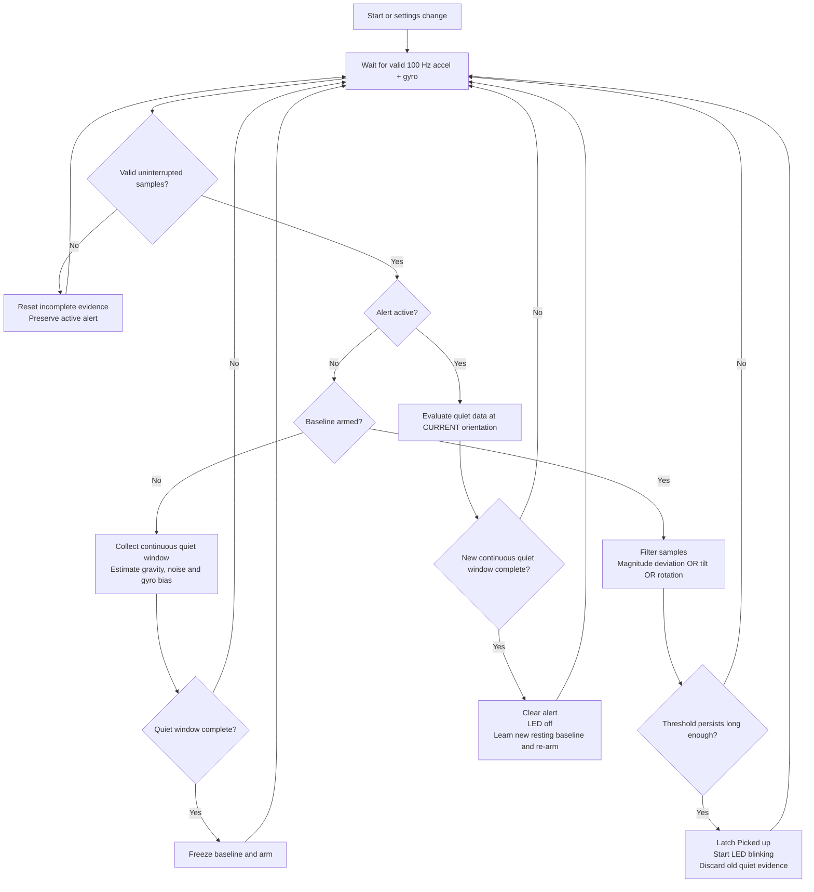

# Pickup detector

The implementation follows the reviewed flow, with automatic clearing after
confirmed stillness. Being held still in a hand counts as stationary; an IMU
cannot prove contact with the desk. This is movement consistent with pickup,
not an absolute height/contact detector. Very gentle straight lifts may be missed.

## Files

- pickup_detector.h: hardware-independent state machine, statistics and filtering.
- pickup_io.h: persistent settings, API validation, status and exclusive LED timer.
- pickup_selftest.h: deterministic tests of the real state machine at startup.
- motion.h: supplies calibrated acceleration plus gyro on every 100 Hz FIFO frame.
- dashboard.h: pickup alert and runtime settings form with firmware-provided limits.

## Flow

## Algorithm blocks

1. Process every 10 ms sensor frame, not one-second graph averages. Smooth
   acceleration and gyro with alpha=10/(smoothing_ms+10). Keep raw vectors for
   stillness statistics so smoothing cannot conceal baseline noise.
2. Maintain a bounded rolling window of acceleration and gyro vectors using
   incremental sums and squared norms. If instantaneous rotation or window RMS
   exceeds the stationary limits, restart quiet evidence. A complete quiet
   window arms the detector; its default duration is 3000 ms (300 frames).
3. Save resting gravity vector, vector acceleration RMS noise and mean gyro
   bias. Freeze that reference while armed; slow tilts must not be learned away.
4. Calculate acceleration-magnitude deviation from the resting magnitude,
   angle between filtered acceleration and the resting vector, and filtered
   gyro magnitude after bias subtraction. Trigger on any condition exceeding
   its limit continuously for trigger_ms. Acceleration uses the greater of the
   fixed trigger and baseline_noise*noise_multiplier. No jerk differentiation
   or position integration is performed.
5. On pickup, clear pre-pickup quiet evidence. The alert remains until a NEW
   quiet window completes. Learn the new position/orientation on clearing;
   it need not match the original gravity vector. Movement within the configured
   stationary limits is, by definition, considered quiet.
6. Sensor faults, FIFO overflow, gaps, calibration or OTA discard incomplete
   evidence and require relearning. They never clear an active alert. Applying
   settings/restoring defaults also preserves an alert until fresh stillness.

The gyro is enabled at +/-250 degrees/s and decoded at 131 counts/(degree/s),
then converted to rad/s. FIFO layout is now 12 bytes: accel XYZ then gyro XYZ,
without temperature. At 100 Hz, the 1024-byte FIFO buffers about 0.85 seconds.
The existing acceleration bias calibration remains separate from detector
baseline learning and is preserved across this firmware update.

## Runtime settings

All defaults are in PickupSettings in pickup_detector.h. The dashboard obtains
names, units, limits, step sizes, values and defaults from firmware metadata.

| Key | Default | Permitted range |
| --- | --- | --- |
| stationary_ms | 3000 ms | 500–10000, step 10 ms |
| stationary_accel_rms | 0.10 m/s² | 0.01–1 |
| stationary_gyro | 0.05 rad/s | 0.005–0.3 |
| accel_trigger | 0.6 m/s² | 0.05–10 |
| noise_multiplier | 6 | 1–20 |
| tilt_deg | 8 degrees | 1–90 |
| gyro_trigger | 0.35 rad/s | 0.05–4 |
| trigger_ms | 150 ms | 20–2000, step 10 ms |
| smoothing_ms | 50 ms | 0–1000, step 10 ms |
| led_period_ms | 1000 ms | 200–10000, step 10 ms |
| led_duty_pct | 50% | 5–95%, step 1% |
| max_gap_ms | 250 ms | 50–1000, step 10 ms |

The stationary acceleration/gyro limits must be below their corresponding
trigger limits. All submitted values must be finite, in range and timing/duty
steps must match. A full candidate is validated before any changes; failed
storage writes leave live settings unchanged. Settings use one versioned NVS
blob in Preferences namespace pickup. Absent/invalid storage falls back to
code defaults. Save settings persists them across reboot. Restore defaults
also persists defaults. Alerts/baselines are not persisted: boot starts learning.

The initial stationary gyro limit applies before bias is learned. A sensor with
large gyro offset may need a higher stationary limit (still below its trigger),
or gyro calibration, before it can establish a baseline. Use live RMS telemetry
rather than arbitrarily reducing trigger sensitivity.

## LED ownership

Acquisition and OTA callbacks no longer write the LED. Only pickup_io.h owns its
initialization and output. A hardware timer drives a short 10 ms ISR, allowing
the configured blink to continue during OTA and NVS operations. Default output
is exactly 500 ms ON / 500 ms OFF while alerting, otherwise OFF. Custom duty
cycles have 10 ms timing granularity. STATUS_LED_PIN/LED_ON still configure the
board pin and polarity; a missing timer/pin is reported as LED unavailable.
LED_PULSE_MS has been removed from both config files.

## API

- GET /api/pickup/settings: persisted flag and field metadata/current/default values.
- POST /api/pickup/settings: complete application/x-www-form-urlencoded form,
  containing every setting exactly once. Returns validated saved settings.
- POST /api/pickup/defaults: restore and persist code defaults.
- GET /api/pickup/status: lightweight detector status.
- GET /api/motion: existing motion/history plus a separate pickup status object.

Status includes active, state, error, quiet_ms, stationary_ms, events,
self_tests_passed, led_available, commanded led_on, accel_deviation, tilt_deg,
rotation_rad_s, accel_rms, gyro_rms and baseline_noise. Dashboard pickup state
refreshes at the existing 1 Hz polling rate, so an alert can appear up to about
one poll interval after the detector/LED react. Stale/error status does not
silently clear the displayed active alert.

## Verification

Startup tests reuse the production detector buffer before settings load and
sensor startup. They do not inject physical motion, write settings, or drive
the LED. Failure disables detector processing and is visible in status/serial.
Tests cover baseline timing, stable rest, brief bumps, acceleration/tilt/gyro
triggers, new-orientation clearing, continued rotation, faults and applying
settings while alerting. Browser tests cover settings rendering/save/defaults,
invalid input/storage errors and active-alert fault messaging.

Manual tests remain necessary: pick up slowly/quickly, hold still for clearing,
put down at a new angle, tap/vibrate the desk without pickup, adjust thresholds,
and check physical 1 Hz/50% LED timing. Repeat with network/OTA activity and
sensor failures. No remote test can establish that all real pickups are detected
or all desk disturbances are rejected.

## Deployed verification

Compilation passed for ESP32 Dev Module; firmware uses 1174103 bytes (89% of
the application slot) and 119512 bytes of static RAM (36%). OTA to 192.168.50.83
succeeded. The initial live check identified an unsupported LED counter-clock
setting; it was corrected to a supported 1 MHz counter with a 10000-tick alarm
(10 ms service). The corrected deployment reports led_available=true.

Real state-machine self-tests passed on boot. Browser tests passed for graphs,
calibration, settings/status rendering, save/default actions, invalid input and
storage errors. A live NaN setting POST returned HTTP 400. A temporary
noise_multiplier=6.5 was saved, survived the OTA restart, and was then restored
to the original value 6 with all original settings saved. No test values remain.

Three final live checks showed state=armed, quiet_ms=3000, active=false,
led_on=false, valid MPU reports with 100/100/101 frames, valid BME reports with
five readings, and zero FIFO overflows. HTTP 200 served the new settings form
and alert UI. Physical pickup sensitivity, false-positive rejection and visible
LED timing still require the manual tests above; they are not established by
these API/self-test results. Sensor calibration restoration across the update
was retained; no automatic flat-pose recalibration was performed.

## Pickup tuning lab

Open **http://<device-IP>/pickup** (currently http://192.168.50.83/pickup), or
follow the main dashboard's tuning link. This separate, self-contained page
includes the same persistent settings API plus 13 debug plot groups:

1. Acceleration departure, fixed trigger, adaptive noise trigger and effective max.
2. Noise-normalized departure, noise multiplier and effective required ratio.
3. Tilt angle and trigger threshold.
4. Filtered rotation rate and trigger threshold.
5. Stationary acceleration RMS and quiet threshold.
6. Instantaneous rotation, quiet-window gyro RMS and stationary rotation limit.
7. Accumulated quiet duration and required stationary duration.
8. Continuous trigger evidence and required persistence.
9. Raw/filtered acceleration magnitudes and frozen resting reference.
10. Peak sample-delivery gap, current sample age, allowed gap and filter time constant.
11. Pickup/armed/commanded-LED state.
12. Observed commanded blink period versus configured period.
13. Observed commanded duty cycle versus configured duty cycle.

Smoothing is a filter coefficient rather than a direct trigger: compare raw and
filtered traces in plot 9 while its configured time constant is plotted in 10.
LED observations refer to firmware-command transitions, not an electrical pin
measurement. They are unavailable until a complete active blink cycle is seen.
If the stationary gyro gate skips RMS evaluation, RMS plots show a gap rather
than an obsolete value; instantaneous rotation explains the rejection.
Reference-dependent features are unavailable until a baseline is learned.

Firmware captures at 20 Hz, plus immediate threshold/gate crossings and state/LED/settings changes. Requests
fetch bounded batches at 5 Hz. Capture is leased for three seconds after each
debug request and stops when no tuning client is requesting it; the detector
itself still evaluates every 100 Hz frame. The on-demand, fixed-capacity debug ring holds 128
records (~6.4 s at 20 Hz, less with extra edges). Its heap buffer is allocated only for a tuning client and released after the three-second lease expires; allocation failure returns HTTP 503 without disturbing detection.
The browser retains up to 600 s; choose 15/30/60/120/600 s view windows. The
60-second default is easier for trigger tuning. Missing sequence/time intervals
are drawn as gaps. Shorter histories fill the width. Pause capture freezes
requests/plots and eventually releases the subscription; resuming after buffer
loss shows gaps rather than fabricated history. Clear plots affects this tab
only. CSV exports the retained telemetry and the historical threshold values.

Each record snapshots the actual thresholds used at that time. Editing a form
alone never changes graph thresholds. Saving applies validated settings and
restarts baseline learning; past plotted thresholds do not change retroactively.
Settings revision changes from another page are reported without overwriting
unsaved inputs. Reload saved settings explicitly to reconcile the form.

GET /api/pickup/debug?since=N returns current pickup status, settings_revision,
oldest/latest sequence, named columns and compact numeric rows. It returns at
most 24 records/request to bound JSON work. Invalid/unavailable metrics serialize
as null. Sequence and uptime identify reboot/reset; the browser clears old data
on reboot. Time is ESP32 processing uptime: FIFO delivery batching can shift
feature timing relative to when physical samples were generated. The gap chart
shows delivery timing, not the MPU's fixed 10 ms sample period.

Files: pickup_tuning.h contains the page; pickup_debug.h contains bounded
capture/serialization. pickup_io.h integrates subscription and settings revision.
The core now refreshes diagnostic features even while alerting, preserves the
confirming trigger-persistence value for capture, and flags skipped RMS updates.
The existing detector thresholds and decision logic are unchanged. Startup
self-tests include live-feature behavior during alerts. Run
`node tests/pickup-tuning.test.cjs` for page/schema/history/settings tests and
`node tests/dashboard.test.cjs` for the main dashboard regression tests.

Tuning-lab deployment verification: compilation passed (1194795 flash bytes,
91% of application slot; 119736 static RAM bytes, 36%). OTA succeeded. The
page returned HTTP 200, and live polling collected 160 records with 37 named
columns, including every configurable threshold/timing parameter. Updated
algorithm self-tests passed. During the check, free heap was at least 99176
bytes and the largest free block at least 42996 bytes. After a 3.7 s pause,
the next request observed an empty/released history buffer, confirming lease
expiry. Final sensor checks showed valid motion with 100 samples/report,
valid BME with five readings/report and zero FIFO overflows. Detector status
can briefly return to baseline learning if the configured acquisition-gap
limit is exceeded; use the gap plot to diagnose it. Browser layout/interaction
and deliberately induced pickup/LED traces still need user verification.

## Persistent gyro zero-rate calibration and display units

The main dashboard now has **Calibrate gyro (keep stationary)**. It collects
500 raw gyro frames (~5 s), checks acceleration and gyro variance for movement,
and stores each axis's mean zero-rate offset in NVS (mpu6050 / gyro-v1).
The module can be in any fixed orientation; unlike accelerometer calibration,
it need not be flat or Z-up. It must genuinely remain stationary: steady yaw
rotation can look like a constant bias and must not be used for calibration.
Gyro calibration never overwrites accelerometer bias. New bias is applied only
if validation and storage succeed. Excessive bias, sensor errors or OTA abort it.
Repeated calibration estimates the full raw bias, not a second subtraction of
an already-corrected value. Offsets restore at boot and apply to both current
readouts and detector input; the detector still learns small residual gyro bias
from stationary baselines.

Main gyro readouts use corrected one-second mean XYZ in **deg/s**. The tuning
page's rotation plots, gyro settings and CSV columns also use deg/s. Wire API
and stored detector settings remain rad/s for compatibility; settings metadata
supplies display_unit/display_scale so the browser converts limits/values into
deg/s and converts submissions back. No existing physical threshold changes.
The API adds gyroscope_deg_s, gyroscope_raw_deg_s and gyro_bias_deg_s, retaining
gyroscope_rad_s as the corrected SI-unit mean. Calibration kind/progress/errors
share the existing motion status. POST /api/motion/calibrate-gyro starts the
stationary calibration. Clear old motion history after success to avoid mixing
corrected and uncorrected samples.

Gyro calibration deployment: compilation/tests and OTA succeeded. The stationary
500-frame measurement saved bias [-2.767,0.429,0.426] deg/s. Subsequent readings
included [0.007,-0.004,-0.007] deg/s. A second OTA restart verified those offsets
restored from NVS; corrected readings were [-0.031,0.037,-0.038] deg/s, valid
with 100 samples/report. Accelerometer offsets remained [0.391,-0.399,1.372]
m/s^2, detector self-tests passed, and both pages served the degree-unit UI.
This removes zero-rate offset only, not gyro scale/axis errors or temperature
drift; recalibrate after warm-up if necessary. Flash: 1199351 bytes (91%);
static RAM: 119824 bytes (36%). No claim of perfect zero noise or absolute
rotation accuracy is made.

### Decision markers in the tuning lab

The `/pickup` graphs now mark confirmed alerts in red and completed stationary
clearing in green at matching timestamps. Trigger plots say `CAUSE` when their
signal exceeded its limit on the confirming frame; `ALERT*` means another signal
contributed instead. Confirmation requires continuous OR evidence for the
configured persistence duration; it does not require the same signal throughout.
The saved cause mask describes the confirming frame, not every earlier contributor.

Amber `RESET` markers appear on relevant stationary plots when a firmware quiet
blocker changes or begins. They identify acceleration RMS, instantaneous gyro,
or gyro RMS rejection. The status panel reports the current blocker or the
remaining quiet-window wait; the recent-event list gives causes and boot-relative
timestamps. Tilt and departure relative to the old baseline do not block clearing
in a new resting orientation. Trigger, blocker and event-counter snapshots are
also included in debug JSON/CSV. Missing records do not imply inferred transitions.
Markers require the tuning page to be capturing; they are not a persistent log.
All thresholds and detector behavior remain unchanged. Physical pickup/clearing
and visual browser verification remain manual checks after flashing this version.
