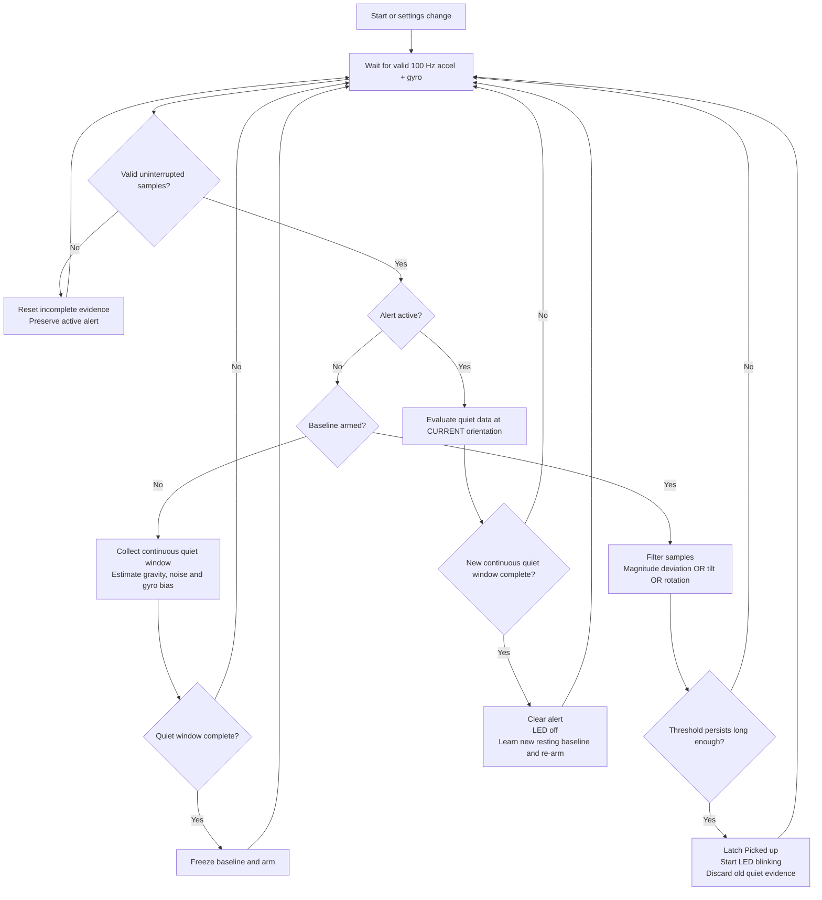

# Pickup detector

The implementation follows the reviewed flow, with automatic clearing after
confirmed stillness. Being held still in a hand counts as stationary; an IMU
cannot prove contact with the desk. This is movement consistent with pickup,
not an absolute height/contact detector. Very gentle straight lifts may be missed.

## Files

- pickup_detector.h: hardware-independent state machine, statistics and filtering.
- pickup_io.h: persistent settings, API validation, status and exclusive LED timer.
- pickup_selftest.h: deterministic tests of the real state machine at startup.
- motion.h: supplies calibrated acceleration plus gyro on every 100 Hz FIFO frame.
- dashboard.h: pickup alert and runtime settings form with firmware-provided limits.

## Flow

## Algorithm blocks

1. Process every 10 ms sensor frame, not one-second graph averages. Smooth
   acceleration and gyro with alpha=10/(smoothing_ms+10). Keep raw vectors for
   stillness statistics so smoothing cannot conceal baseline noise.
2. Maintain a bounded rolling window of acceleration and gyro vectors using
   incremental sums and squared norms. If instantaneous rotation or window RMS
   exceeds the stationary limits, restart quiet evidence. A complete quiet
   window arms the detector; its default duration is 3000 ms (300 frames).
3. Save resting gravity vector, vector acceleration RMS noise and mean gyro
   bias. Freeze that reference while armed; slow tilts must not be learned away.
4. Calculate acceleration-magnitude deviation from the resting magnitude,
   angle between filtered acceleration and the resting vector, and filtered
   gyro magnitude after bias subtraction. Trigger on any condition exceeding
   its limit continuously for trigger_ms. Acceleration uses the greater of the
   fixed trigger and baseline_noise*noise_multiplier. No jerk differentiation
   or position integration is performed.
5. On pickup, clear pre-pickup quiet evidence. The alert remains until a NEW
   quiet window completes. Learn the new position/orientation on clearing;
   it need not match the original gravity vector. Movement within the configured
   stationary limits is, by definition, considered quiet.
6. Sensor faults, FIFO overflow, gaps, calibration or OTA discard incomplete
   evidence and require relearning. They never clear an active alert. Applying
   settings/restoring defaults also preserves an alert until fresh stillness.

The gyro is enabled at +/-250 degrees/s and decoded at 131 counts/(degree/s),
then converted to rad/s. FIFO layout is now 12 bytes: accel XYZ then gyro XYZ,
without temperature. At 100 Hz, the 1024-byte FIFO buffers about 0.85 seconds.
The existing acceleration bias calibration remains separate from detector
baseline learning and is preserved across this firmware update.

## Runtime settings

All defaults are in PickupSettings in pickup_detector.h. The dashboard obtains
names, units, limits, step sizes, values and defaults from firmware metadata.

| Key | Default | Permitted range |
| --- | --- | --- |
| stationary_ms | 3000 ms | 500–10000, step 10 ms |
| stationary_accel_rms | 0.10 m/s² | 0.01–1 |
| stationary_gyro | 0.05 rad/s | 0.005–0.3 |
| accel_trigger | 0.6 m/s² | 0.05–10 |
| noise_multiplier | 6 | 1–20 |
| tilt_deg | 8 degrees | 1–90 |
| gyro_trigger | 0.35 rad/s | 0.05–4 |
| trigger_ms | 150 ms | 20–2000, step 10 ms |
| smoothing_ms | 50 ms | 0–1000, step 10 ms |
| led_period_ms | 1000 ms | 200–10000, step 10 ms |
| led_duty_pct | 50% | 5–95%, step 1% |
| max_gap_ms | 250 ms | 50–1000, step 10 ms |

The stationary acceleration/gyro limits must be below their corresponding
trigger limits. All submitted values must be finite, in range and timing/duty
steps must match. A full candidate is validated before any changes; failed
storage writes leave live settings unchanged. Settings use one versioned NVS
blob in Preferences namespace pickup. Absent/invalid storage falls back to
code defaults. Save settings persists them across reboot. Restore defaults
also persists defaults. Alerts/baselines are not persisted: boot starts learning.

The initial stationary gyro limit applies before bias is learned. A sensor with
large gyro offset may need a higher stationary limit (still below its trigger),
or gyro calibration, before it can establish a baseline. Use live RMS telemetry
rather than arbitrarily reducing trigger sensitivity.

## LED ownership

Acquisition and OTA callbacks no longer write the LED. Only pickup_io.h owns its
initialization and output. A hardware timer drives a short 10 ms ISR, allowing
the configured blink to continue during OTA and NVS operations. Default output
is exactly 500 ms ON / 500 ms OFF while alerting, otherwise OFF. Custom duty
cycles have 10 ms timing granularity. STATUS_LED_PIN/LED_ON still configure the
board pin and polarity; a missing timer/pin is reported as LED unavailable.
LED_PULSE_MS has been removed from both config files.

## API

- GET /api/pickup/settings: persisted flag and field metadata/current/default values.
- POST /api/pickup/settings: complete application/x-www-form-urlencoded form,
  containing every setting exactly once. Returns validated saved settings.
- POST /api/pickup/defaults: restore and persist code defaults.
- GET /api/pickup/status: lightweight detector status.
- GET /api/motion: existing motion/history plus a separate pickup status object.

Status includes active, state, error, quiet_ms, stationary_ms, events,
self_tests_passed, led_available, commanded led_on, accel_deviation, tilt_deg,
rotation_rad_s, accel_rms, gyro_rms and baseline_noise. Dashboard pickup state
refreshes at the existing 1 Hz polling rate, so an alert can appear up to about
one poll interval after the detector/LED react. Stale/error status does not
silently clear the displayed active alert.

## Verification

Startup tests reuse the production detector buffer before settings load and
sensor startup. They do not inject physical motion, write settings, or drive
the LED. Failure disables detector processing and is visible in status/serial.
Tests cover baseline timing, stable rest, brief bumps, acceleration/tilt/gyro
triggers, new-orientation clearing, continued rotation, faults and applying
settings while alerting. Browser tests cover settings rendering/save/defaults,
invalid input/storage errors and active-alert fault messaging.

Manual tests remain necessary: pick up slowly/quickly, hold still for clearing,
put down at a new angle, tap/vibrate the desk without pickup, adjust thresholds,
and check physical 1 Hz/50% LED timing. Repeat with network/OTA activity and
sensor failures. No remote test can establish that all real pickups are detected
or all desk disturbances are rejected.

## Deployed verification

Compilation passed for ESP32 Dev Module; firmware uses 1174103 bytes (89% of
the application slot) and 119512 bytes of static RAM (36%). OTA to 192.168.50.83
succeeded. The initial live check identified an unsupported LED counter-clock
setting; it was corrected to a supported 1 MHz counter with a 10000-tick alarm
(10 ms service). The corrected deployment reports led_available=true.

Real state-machine self-tests passed on boot. Browser tests passed for graphs,
calibration, settings/status rendering, save/default actions, invalid input and
storage errors. A live NaN setting POST returned HTTP 400. A temporary
noise_multiplier=6.5 was saved, survived the OTA restart, and was then restored
to the original value 6 with all original settings saved. No test values remain.

Three final live checks showed state=armed, quiet_ms=3000, active=false,
led_on=false, valid MPU reports with 100/100/101 frames, valid BME reports with
five readings, and zero FIFO overflows. HTTP 200 served the new settings form
and alert UI. Physical pickup sensitivity, false-positive rejection and visible
LED timing still require the manual tests above; they are not established by
these API/self-test results. Sensor calibration restoration across the update
was retained; no automatic flat-pose recalibration was performed.
